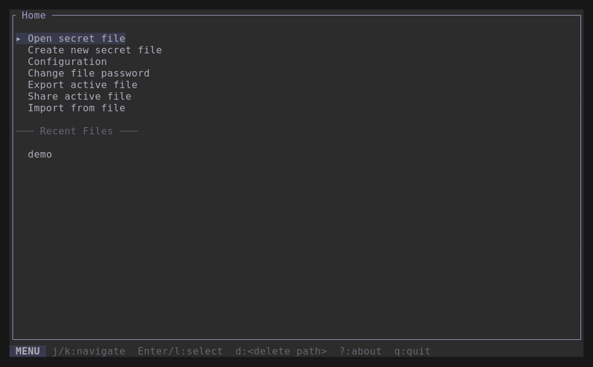

# cretopass

Offline terminal password manager: a TUI, written in Rust, over one age-encrypted file.
A tree of secrets in the terminal. One file. No network.



- Search, copy, add a node that is not only a password.
- You specify the file where secrets are stored.
- No network calls.
- Vim style navigation.
- Custom fields
- Generate logins and passwords.

## Install

### Linux and macOS, no Rust toolchain:

```sh
curl -fsSL https://github.com/Dmitrytuk/cretopass/releases/latest/download/install.sh | sh
```

### Windows:

```powershell
irm https://github.com/Dmitrytuk/cretopass/releases/latest/download/install.ps1 | iex
```

### Crates io:

```sh
cargo install cretopass
```

## Update

The app does not update itself. Re-run the same command. 

## Remove

`cretopass remove` deletes the installed app and its config.

## Security

Files are encrypted with [age](https://age-encryption.org) and a passphrase (scrypt). Without the passphrase the file is ciphertext.

Each save writes a new temporary file, syncs it, and renames it over the target. New secret files are owner-only. A copy reaches the system clipboard only when you press `c` or `y` on a field.

## Data

| Path | Purpose |
|------|---------|
| `~/.config/cretopass/config.pwd` | Settings and the recent-files list. Not the vault. |

## Feedback

Bugs and requests: <https://github.com/Dmitrytuk/cretopass/issues>

Vulnerabilities: do not open a public issue. Use [private reporting](https://github.com/Dmitrytuk/cretopass/security/advisories/new) ([SECURITY.md](SECURITY.md)).

## License

MIT — [LICENSE](LICENSE). Third-party licenses: [LICENSE-THIRD-PARTY](LICENSE-THIRD-PARTY).
